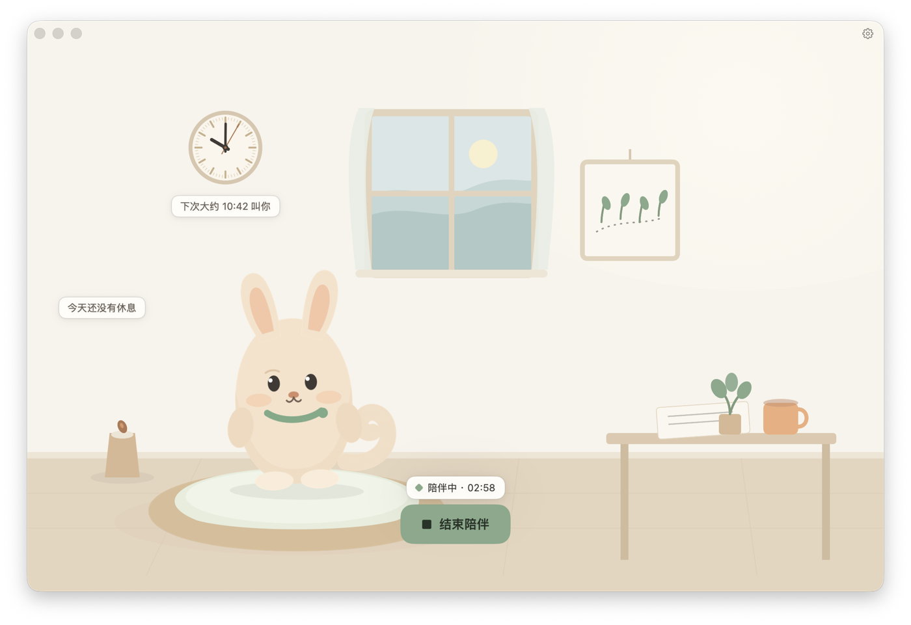
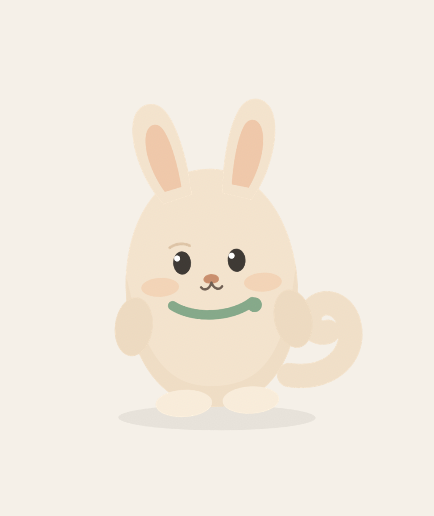
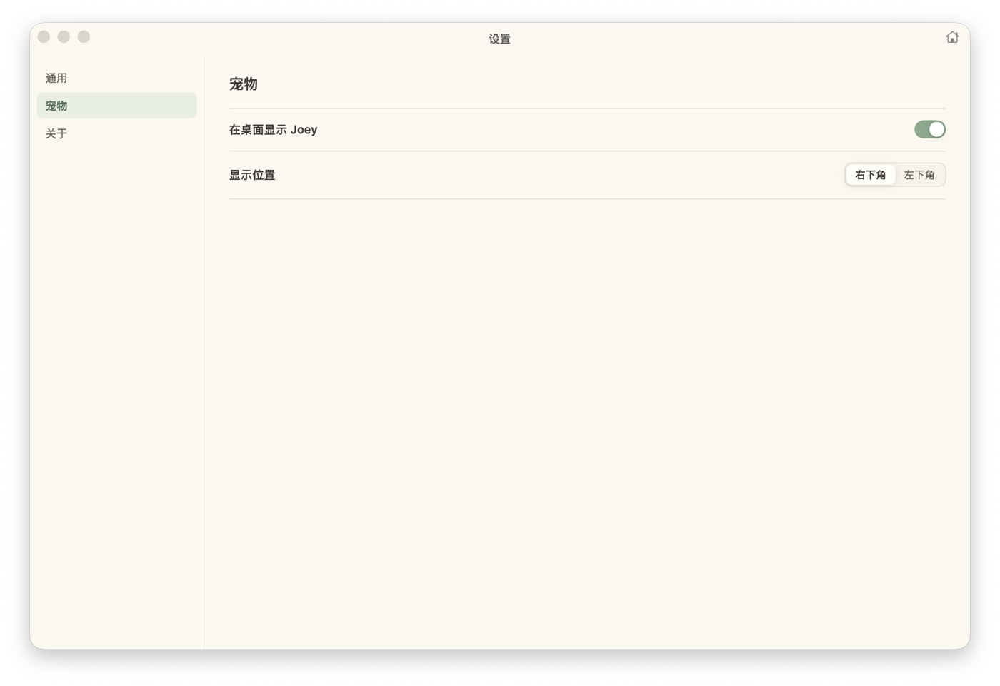

# JoeyPet

[简体中文](./README.zh-CN.md)

JoeyPet is a native macOS desktop pet. Joey lives quietly on your desktop, keeps you company while you work, and gently invites short breaks when it’s time to rest.

<p align="center">
  
</p>

<p align="center">
  
  &nbsp;&nbsp;&nbsp;
  
</p>

## Installation

**Requires** macOS 14 or later.

1. Download the latest release from [Releases](https://github.com/zguiyang/JoeyPet/releases/latest):
   - **JoeyPet-*-macOS.dmg** (recommended) — open the disk image and drag `JoeyPet` into **Applications**
   - **JoeyPet-*-macOS.zip** — unzip, then move `JoeyPet.app` into **Applications**
2. Open JoeyPet from Applications (or Launchpad).

### If macOS blocks the app

The first launch may be blocked. Use **either** method once:

**Method 1 — System Settings**

1. Try to open JoeyPet. If a dialog says it can’t be opened, click **Done** / close it.
2. Open **System Settings → Privacy & Security**.
3. Scroll to **Security**. Find the message about JoeyPet and click **Open Anyway**.
4. Confirm when prompted, then open JoeyPet again.

**Method 2 — Terminal**

```bash
xattr -cr /Applications/JoeyPet.app
```

Then open JoeyPet normally. If the app is not in Applications, replace the path with where `JoeyPet.app` actually is.

## Features

- [x] Desktop Joey — drag, hide, show; quiet presence on the desktop
- [x] Start a work companionship session from the nest
- [x] Rest invites on your interval — take a break, snooze, or Do Not Disturb
- [x] Short recoveries with rotating recipes (look far / stand & blink / walk & stretch / hydrate)
- [x] Nest home — today’s focus time, rest count, and next invite hint
- [x] Light shared growth in the nest as you keep company
- [x] Reflection — today and recent days, without scores or rankings
- [x] Settings — rest interval, quiet hours, Do Not Disturb, desktop show/hide, position
- [ ] Custom pet models / appearances
- [ ] Custom cue / ambient sounds
- [ ] AI companionship

## License

JoeyPet is licensed under the [PolyForm Noncommercial License 1.0.0](./LICENSE).

- Personal / noncommercial use: free
- Redistribution and modification: allowed if you keep the copyright notice and license
- Commercial use: requires a paid authorization — contact [zhaoguiyang18@outlook.com](mailto:zhaoguiyang18@outlook.com)
