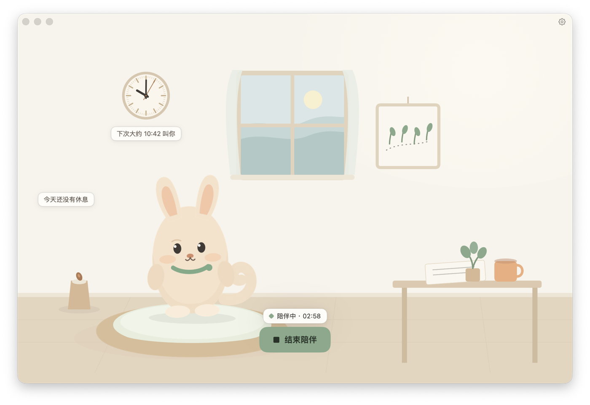
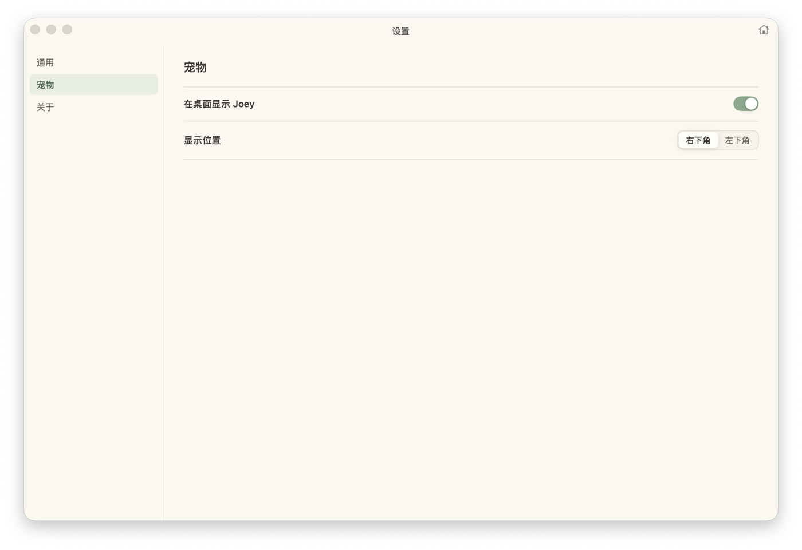

# JoeyPet

[English](./README.md)

JoeyPet 是一款原生 macOS 桌面宠物。Joey 安静地生活在桌面上，陪你工作，并在到点时温和地邀请你短暂休息。

<p align="center">
  
</p>

<p align="center">
  
  &nbsp;&nbsp;&nbsp;
  
</p>

## 安装

**系统要求**：macOS 14 或更高。

1. 从 [Releases](https://github.com/zguiyang/JoeyPet/releases/latest) 下载最新版本：
   - **JoeyPet-*-macOS.dmg**（推荐）— 打开磁盘映像，把 `JoeyPet` 拖进「应用程序」
   - **JoeyPet-*-macOS.zip** — 解压后，把 `JoeyPet.app` 移到「应用程序」
2. 从「应用程序」或启动台打开 JoeyPet。

### 如果系统提示无法打开

首次打开可能被 macOS 拦截。任选下面一种方式处理一次即可：

**方式 1 — 系统设置**

1. 尝试打开 JoeyPet。若提示无法打开，点「完成」或关掉对话框。
2. 打开 **系统设置 → 隐私与安全性**。
3. 滚到 **安全性**，找到关于 JoeyPet 的提示，点 **仍要打开**。
4. 确认后，再打开一次 JoeyPet。

**方式 2 — 终端命令**

```bash
xattr -cr /Applications/JoeyPet.app
```

然后正常打开即可。若不在「应用程序」里，把路径改成 `JoeyPet.app` 的实际位置。

## 功能

- [x] 桌面 Joey — 拖动、隐藏、显示；安静陪伴
- [x] 从小窝主动开始工作陪伴
- [x] 按你设置的间隔发出休息邀请 — 休息一下 / 稍后 / 勿扰
- [x] 短恢复处方轮换（眺望 / 站立揉眼 / 走动伸展 / 喝水）
- [x] 小窝主页 — 今日专注、休息次数、下一次邀请提示
- [x] 陪伴带来的小窝轻成长
- [x] 节奏回顾 — 今天与近几日，无评分排名
- [x] 设置 — 休息间隔、安静时段、勿扰、桌面显示、位置
- [ ] 自定义宠物形象 / 模型
- [ ] 自定义提示音 / 环境音
- [ ] AI 陪伴
